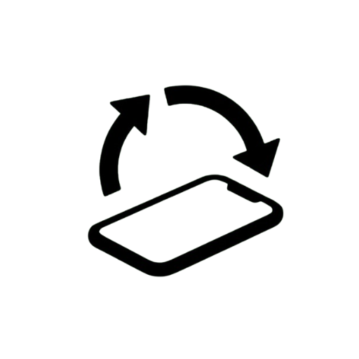
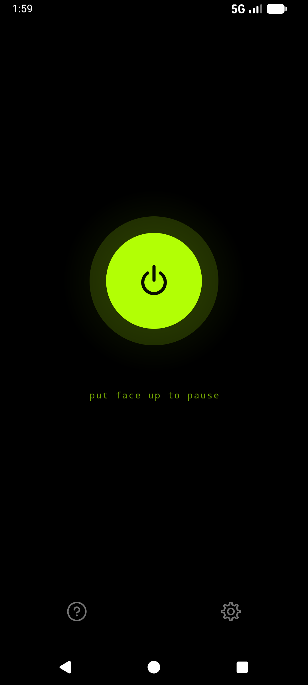
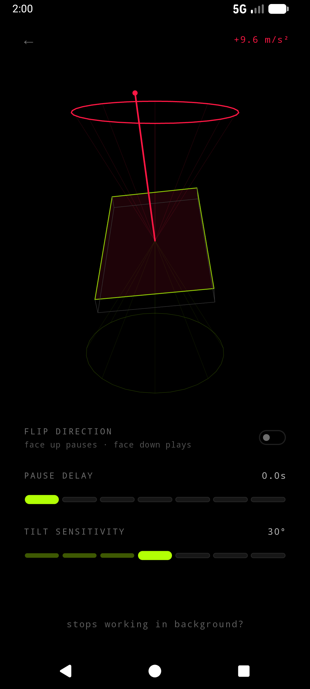
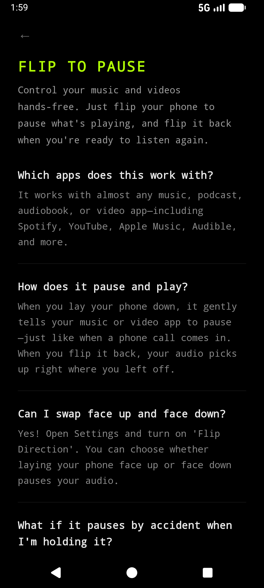

<div align="center">



# Flip to Pause

**Hands-free media control for Android.**  
Flip your phone to automatically pause music, podcasts, audiobooks, or videos — flip it back to resume right where you left off.

[-B2FF05?style=flat-square&logo=android&logoColor=black)](#)
[](#)
[](#)

</div>

---

## ✨ Screenshots

<div align="center">
  
  &nbsp;&nbsp;
  
  &nbsp;&nbsp;
  
</div>

---

## 🚀 Features

- **Instant Orientation Control:** Lay your phone flat to pause active playback; flip it over to resume immediately.
- **Universal Compatibility:** Works seamlessly with Spotify, YouTube, Apple Music, Audible, Pocket Casts, and any media player that respects standard Android audio focus.
- **Live 3D Orientation Visualizer:** Interactive 3D wireframe phone & cone visualizer in Settings with real-time `m/s²` gravity readout and boundary haptic ticks.
- **Customizable Behavior:**
    - **Flip Direction:** Choose whether face-up or face-down pauses your media.
    - **Pause Delay:** Step between `0.0s` and `3.0s` to ignore accidental tilts while holding your phone.
    - **Tilt Sensitivity:** Adjust the trigger cone angle from `15°` to `60°`.
- **Quick Settings Tile:** Toggle Flip to Pause on or off straight from your Android notification shade.
- **Ultra-Lightweight & Zero Dependencies:**
    - Written in pure Kotlin using custom `Canvas` views — no Jetpack Compose, no AppCompat, no Material library bloat.
    - True `#000000` AMOLED dark UI.
- **100% Private:** Does not request `INTERNET` permission. Zero ads, zero analytics, zero tracking.

---

## 🛠️ Tech Stack & Architecture

- **100% Kotlin** with **0 external dependencies** (`dependencies {}` is completely empty).
- **Custom Canvas Rendering:** Every UI component—including the pulsing neon power button, 3D perspective device/cone visualizer, vector icons, pill switches, and discrete steppers—is drawn directly on Android `Canvas`.
- **Hardware Sensor Integration:** Uses `Sensor.TYPE_GRAVITY` (with `Sensor.TYPE_ACCELEROMETER` fallback) at low-power polling intervals with zero wake locks.
- **Dynamic Built-in Localization:** Supports English, Spanish, Hindi, French, German, Portuguese, Japanese, and Russian out-of-the-box without XML bloat.

---

## 📦 Building from Source

Clone the repository and build the APK using Gradle:

```bash
git clone https://github.com/omkartenkale/FlipToPause.git
cd FlipToPause
./gradlew assembleDebug